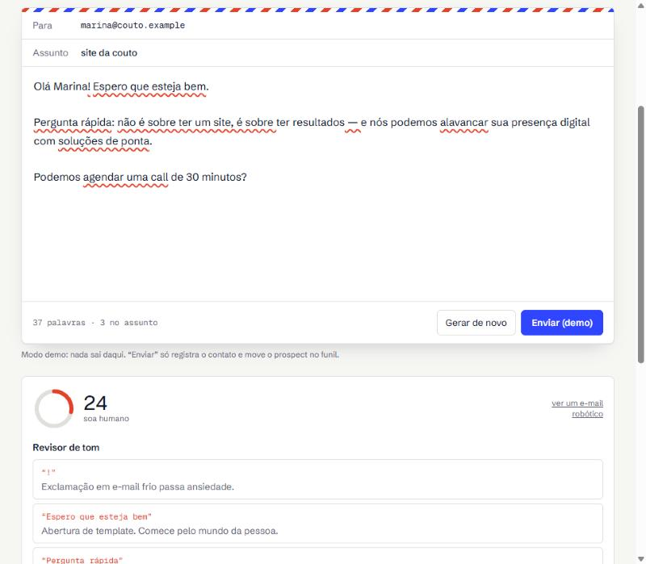

# outreach

**PT** · CRM de prospecção para freelancers: lista de prospects, gerador de cold e-mails personalizados com revisor de tom, sequências de follow-up e funil de respostas. Roda em modo demo: nenhum e-mail é enviado.
**EN** · Prospecting CRM for freelancers: prospect lists, personalized cold-email drafts with a live "sounds-like-AI" linter, follow-up sequences and a reply funnel. Demo mode: no email is ever sent.

🔗 **Ao vivo / Live:** https://outreach-vhcode.vercel.app



## Português

### Telas
- **Funil** · kanban com arrastar e soltar (e menu de etapa em cada card, para teclado e celular), valor em aberto por etapa
- **Prospects** · busca, filtro por segmento, importação e exportação de CSV
- **Escrever** · rascunho gerado a partir do *sinal* (o que você notou) e da *dor provável*; três tons; assunto curto em minúsculas; pedido de baixo atrito; linha de descadastro
- **Revisor de tom** · sublinha no próprio texto o que soa como template ou IA (abertura pronta, travessão, “não é X, é Y”, jargão, pedido de reunião de 30 min) e dá uma nota de 0 a 100
- **Sequências** · 4 toques (dia 0, 3, 7 e 14), cada um com um ângulo novo e e-mail de despedida no fim; param sozinhos quando a pessoa responde
- **Respostas** · classificação automática (interessado, dúvida, objeção, agora não, indicação, fora do escritório, descadastro) com o próximo passo sugerido

### Segurança
- CSV exportado neutraliza injeção de fórmula (`=`, `+`, `-`, `@` no início da célula)
- Importação limita tamanho do arquivo, número de linhas e tamanho de cada campo, e valida e-mail
- Nenhum HTML vindo do usuário é renderizado; tudo passa como texto
- Cabeçalhos: CSP, HSTS, X-Frame-Options, nosniff, Referrer-Policy, Permissions-Policy
- Dados ficam só no `localStorage` do navegador

### Stack
Next.js 16 · React 19 · TypeScript · Tailwind CSS 4 · Motion · Vitest

### Como rodar
```bash
npm install
npm run dev
npm test
npm run build
```

## English

### Screens
- **Pipeline** · drag-and-drop kanban (plus a stage menu per card for keyboard/touch)
- **Prospects** · search, segment filter, CSV import/export
- **Compose** · draft built from the prospect's signal and likely pain; three tones; short lowercase subject; low-friction ask; opt-out line
- **Tone linter** · underlines template/AI tells inline and scores the draft 0–100
- **Sequences** · 4 touches (day 0/3/7/14), new angle each time, breakup email; auto-stop on reply
- **Replies** · auto-classified with a suggested next step

### Security
CSV formula-injection guard, bounded imports, no user HTML rendered, strict headers (CSP, HSTS, etc.), local-only storage.

### Stack
Next.js 16 · React 19 · TypeScript · Tailwind CSS 4 · Motion · Vitest
